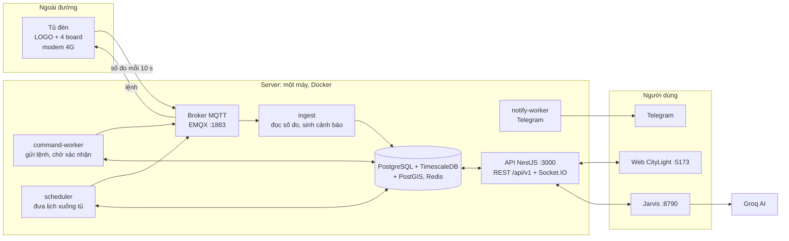
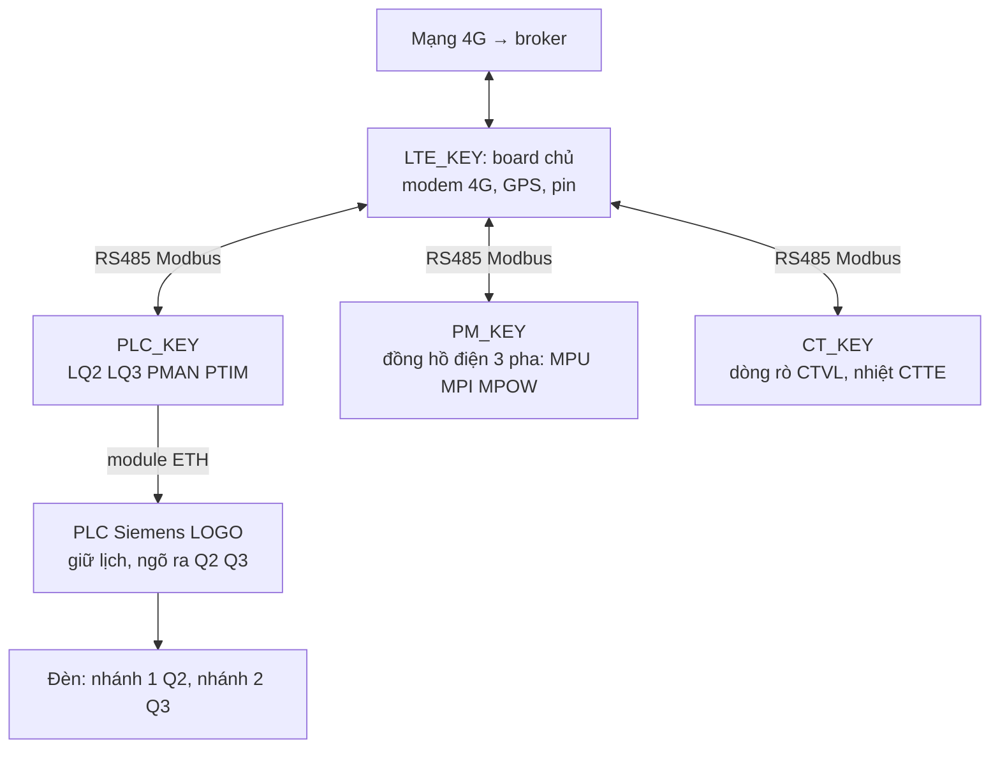
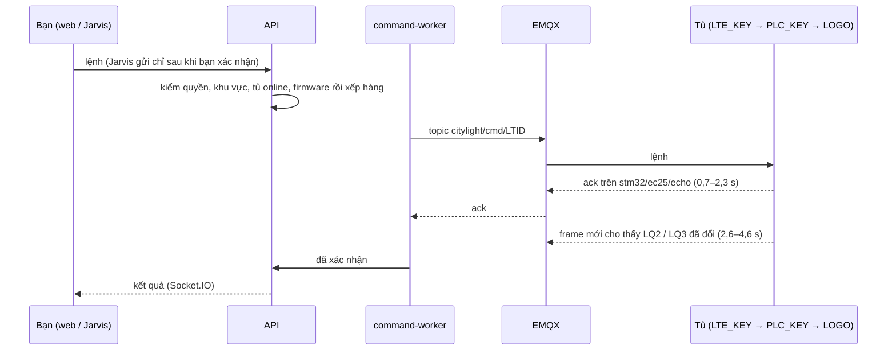
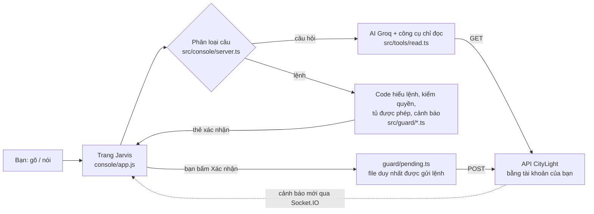

# Tổng quan hệ thống CityLight + Jarvis (cập nhật 28/11/2026)

<!-- Khuôn: E:\TEMPLATE\project\docs\OVERVIEW.md. Cập nhật khi thêm / bớt một phần hoặc đổi cách các phần nói chuyện. -->

Bản có hình, bấm được: [`docs/system-map.html`](system-map.html) (mở bằng trình duyệt) hoặc https://claude.ai/artifact/Esdem7pGbwpX4guyQ8Pahg (riêng tư, tài khoản Claude của bạn).

## 1. Một câu

Hệ thống **giám sát và điều khiển tủ chiếu sáng công cộng**: tủ đèn ngoài đường gửi số đo lên server qua 4G, người vận hành xem và ra lệnh qua **web CityLight** hoặc **Jarvis** (trợ lý tiếng Việt). Lịch bật tắt nằm sẵn trong tủ, nên server sập thì đèn vẫn chạy.

## 2. Sơ đồ toàn cảnh

## 3. Các phần

| Phần | Làm gì | Công nghệ | Code ở đâu | Cổng |
|---|---|---|---|---|
| Tủ đèn | PLC Siemens LOGO giữ lịch, đóng ngắt 2 nhánh đèn; 4 board STM32 đo và nói chuyện với server | STM32, Modbus RS485, modem EC25 4G | `E:\CITY_LIGHT\city_light_v2` (firmware); tủ giả: `server_citylight/apps/simulator` | MQTT ra 1883 |
| Broker MQTT | Trung chuyển: tủ gửi số đo lên, server gửi lệnh xuống; bắt buộc tài khoản, chỉ backend được gửi lệnh | EMQX | `server_citylight/infra/emqx` | 1883 |
| ingest | Đọc frame, lọc giá trị vô lý, lưu, cập nhật trạng thái, mở / đóng cảnh báo, phát hiện mất kết nối | Node / TypeScript | `server_citylight/apps/workers/src/ingest.ts` | |
| command-worker | Lấy lệnh từ hàng đợi, gửi xuống tủ, chờ ack, chờ số đo xác nhận đèn đổi | Node / TypeScript | `server_citylight/apps/workers/src/command-worker.ts` | |
| scheduler | Đưa lịch (riêng tủ / vùng / thiên văn) xuống LOGO | Node / TypeScript | `server_citylight/apps/workers/src/scheduler.ts` | |
| notify-worker | Gửi cảnh báo, nhắc sự cố quá hạn qua Telegram | Node / TypeScript | `server_citylight/apps/workers/src/notify-worker.ts` | |
| Cơ sở dữ liệu | Tủ, người dùng, lệnh, cảnh báo, sự cố; số đo theo thời gian; bản đồ tuyến / trụ / đèn | PostgreSQL 16 + TimescaleDB + PostGIS, Redis | `server_citylight/packages/db` | (trong Docker) |
| API | Cửa duy nhất vào dữ liệu: đăng nhập, 2 lớp, quyền theo khu vực, đọc, nhận lệnh; đẩy thay đổi tức thì | NestJS, Socket.IO | `server_citylight/apps/api` | 3000 |
| Web CityLight | Bản đồ, chi tiết tủ, điều khiển, lịch, lệnh hàng loạt, cảnh báo, sự cố, GIS, quản trị; nút ✦ mở Jarvis | React, Vite | `server_citylight/apps/web` (nhánh `dthien_jarvis_web`) | 5173 |
| **Jarvis** | Hỏi dữ liệu, ra lệnh có xác nhận, tự báo cảnh báo và đọc to, bản tin đầu ca; 2 lớp riêng có mã QR | Node / TypeScript, SQLite | `E:\CITY_LIGHT\jarvis\apps\jarvis` (repo này) | 8790 |
| Giọng nói | Đọc to (Piper); nghe qua Groq | Python sidecar | `apps/jarvis/voice/sidecar.py` | 8791 |
| Groq | AI hiểu câu hỏi, gọi công cụ đọc (model `openai/gpt-oss-20b`); nghe giọng nói | Dịch vụ trên mạng | khóa `GROQ_API_KEY` | |

### Bên trong một tủ

| Mã cảnh báo | Hỏng ở đâu |
|---|---|
| E101 | Cả tủ mất kết nối (không còn frame khoảng 60 s) |
| E201 / E202 / E203 | Board PLC_KEY / PM_KEY / CT_KEY không trả lời |
| E204 | Mất cả 3 board con |
| E301 | Mất LOGO, có nguyên nhân: `PLGO` = 2 module ETH không trả lời, 3 rút cáp LAN |
| E303 | Lệch lịch (đèn sáng lúc lẽ ra tắt hoặc ngược lại) |
| E1xx–E8xx khác | Quá / thấp áp, mất pha, rò điện, nhiệt, sai giờ, sự kiện lệnh (E7xx), nghi giả mạo (E8xx) |

Frame gửi lên: `*#LTID'TM01.0001&LQ2'1&LQ3'0&PMAN'1…$`. `LQ2` / `LQ3` = nhánh 1 / 2 đang sáng thật, `PMAN` = đang chạy tay. Tủ gửi mỗi 10 s; đèn đổi thì gửi ngay trong 0,5 s.

## 4. Luồng chính

### Số đo đi lên

1. LTE_KEY gom số đo 3 board con thành một frame, gửi lên topic `electrical_cabinets_default` mỗi 10 s.
2. EMQX chỉ nhận tủ có tài khoản; IMEI lạ bị bỏ (E805).
3. ingest tách frame, lọc, ghi TimescaleDB (từng frame giữ 30 ngày, bảng tổng hợp lâu hơn), cập nhật trạng thái tủ.
4. API đẩy thay đổi qua Socket.IO: bản đồ web đổi màu, Jarvis biết ngay.
5. Tủ im lặng khoảng 60 s → mất kết nối, cảnh báo E101 (đo được 52–64 s).

### Lệnh đi xuống

Mỗi tủ chỉ một lệnh cùng lúc; quá giờ thì báo hết hạn. Lệnh nhiều tủ cần mã 2 lớp 6 số.

### Cảnh báo

1. ingest so mỗi frame với ngưỡng, với lịch (E303), với board nào im lặng (E201–E204).
2. Lỗi kéo dài 30 s mới mở cảnh báo; hết lỗi thì tự đóng.
3. Web hiện ngay; notify-worker gửi Telegram; Jarvis tự lên tiếng và đọc to (nghiêm trọng: tối đa 3 lần, cách 2 phút, tới khi bạn phản hồi).
4. "Xác nhận đã xem" chỉ ghi nhận; cần ra hiện trường thì tạo sự cố, giao người bảo trì.

### Bên trong Jarvis: câu hỏi và lệnh đi hai đường

- AI không bao giờ gửi lệnh. Câu trả lời quan trọng (bản tin đầu ca, danh sách cảnh báo, một tủ) do code dựng sẵn (`ban_tin`, `cau_mau`), AI chỉ đọc lại.
- Câu cố hỏi về tài khoản, mật khẩu, cách tấn công bị chặn ở 4 lớp (`src/guard/account.ts`, D59–D61).

## 5. Chạy ở đâu

| Nơi | Dùng để | Địa chỉ / cách vào | Ghi chú |
|---|---|---|---|
| Máy của bạn | Viết code, chạy test | `E:\CITY_LIGHT\jarvis`, `server_citylight`, `city_light_v2` | Đẩy lên repo của bạn: remote `mine` |
| Codespace | Thử như thật | GitHub Codespaces `organic space bassoon` | 1.000 tủ trong dữ liệu, trình giả lập chạy 65 tủ; cổng 3000 / 5173 / 8790 / 8791; ngủ sau 30 phút không dùng |
| Máy thật (production) | Khách dùng | VPS AWS (Sydney), server của Bảo | Tủ thật `TM01.0001`; Jarvis **chưa** trỏ vào, phải hỏi Bảo trước |

## 6. Ai được làm gì

Mỗi khách một server riêng. Trong một server: **Nhà cung cấp** (phía mình: bạn, Bảo) › **Quản lý** (cao nhất phía khách) › **Điều hành** (ra lệnh được) › **Bảo trì** (xử lý sự cố) · **Xem** (chỉ đọc). Mỗi người chỉ thấy khu vực được giao. Dùng Jarvis còn cần quản trị viên cấp quyền riêng trong mục Quản trị của Jarvis.

## 7. Từ hay gặp

| Từ | Nghĩa |
|---|---|
| LTID | Mã tủ, ví dụ `TL01.0009`: hai chữ, số quận, số thứ tự |
| MQTT, topic | Cách tủ và server nói chuyện: gửi tin lên một topic, ai đăng ký topic đó thì nhận |
| Frame | Một gói số đo tủ gửi lên, dạng `*#KEY'VAL&…$` |
| Ack / xác nhận | Ack: tủ báo đã nhận lệnh. Xác nhận: số đo cho thấy đèn đổi thật |
| Chạy tay / theo lịch | Chạy tay: đèn giữ theo lệnh tới mốc lịch kế tiếp. Theo lịch: LOGO tự bật tắt |
| T1 / T2 / T3 | Mức lệnh trong Jarvis. T1: "xác nhận" là gửi. T2 (tắt đèn): đúng chữ "xác nhận" hoặc nút. T3 (nhiều tủ): chỉ nút, kèm mã 6 số |
| D… / S… | Số quyết định: Jarvis `docs/DECISIONS.md` (D…), server `server_citylight/docs/decisions.md` (S…) |
| 2 lớp Jarvis | Mã 6 số riêng của Jarvis (mục "Jarvis CityLight" trong ứng dụng xác thực), dùng khi tài khoản chưa bật 2 lớp trên CityLight |

## 8. Hình minh họa và tài liệu thêm

- Trang có hình, bấm được: [`docs/system-map.html`](system-map.html); bản trên claude.ai: https://claude.ai/artifact/Esdem7pGbwpX4guyQ8Pahg
- Đặc tả Jarvis: [`docs/SPEC.md`](SPEC.md)
- Kỹ thuật Jarvis (API đã xác minh, số đo, cài đặt): [`apps/jarvis/README.md`](../apps/jarvis/README.md)
- Server CityLight: `server_citylight/docs/overview.md`, `spec.md`, `device-contract.md`, `runbook.md`
